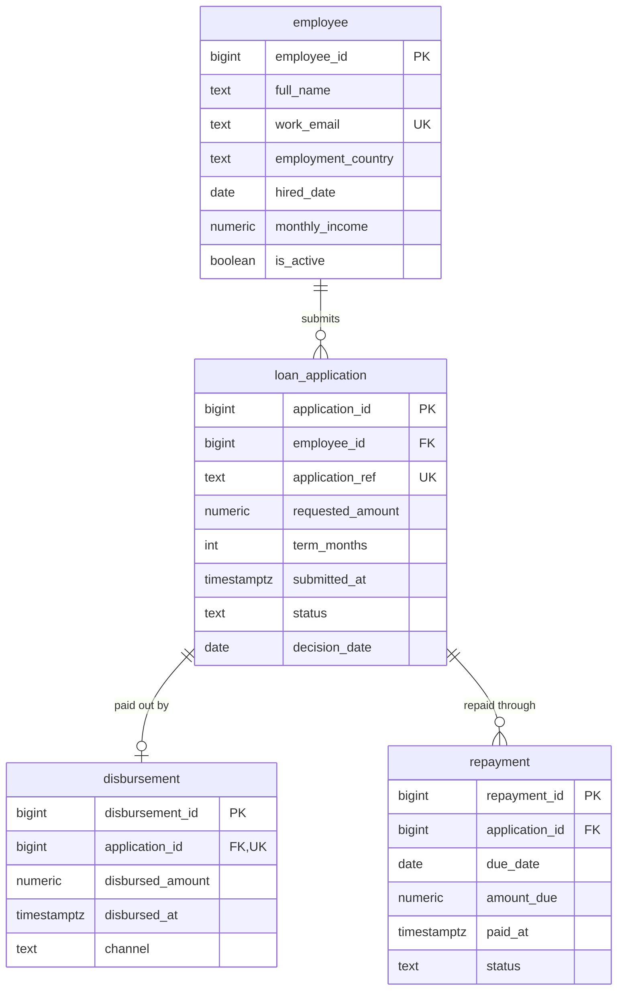

# Portfolio 1 — Entity Relationship Diagram (RemoteFund)

The RemoteFund data-loan platform has four entities. An **employee** (remote worker)
submits **loan_application**s; an approved application receives exactly one
**disbursement** and a schedule of **repayment**s.

**Key**: PK = primary key, FK = foreign key, UK = unique.

**Relationships**
- `employee (1) —— (many) loan_application` — one worker can submit many applications over time (but only one *open* at a time, enforced by a partial unique index).
- `loan_application (1) —— (0 or 1) disbursement` — an application is paid out at most once; `disbursement.application_id` is unique.
- `loan_application (1) —— (many) repayment` — a loan is repaid over a schedule; `(application_id, due_date)` is unique so there are no duplicate instalments on the same date.
